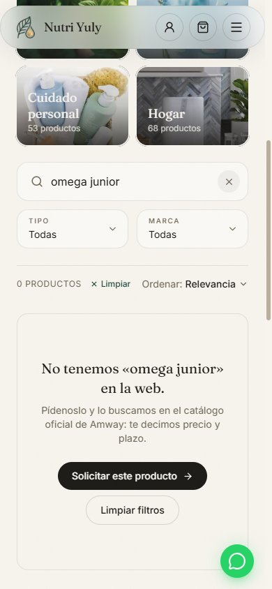
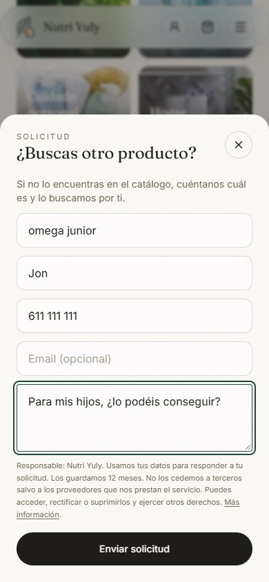
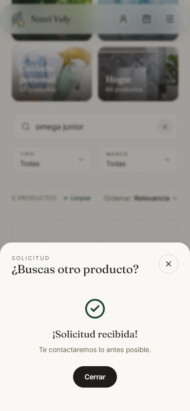
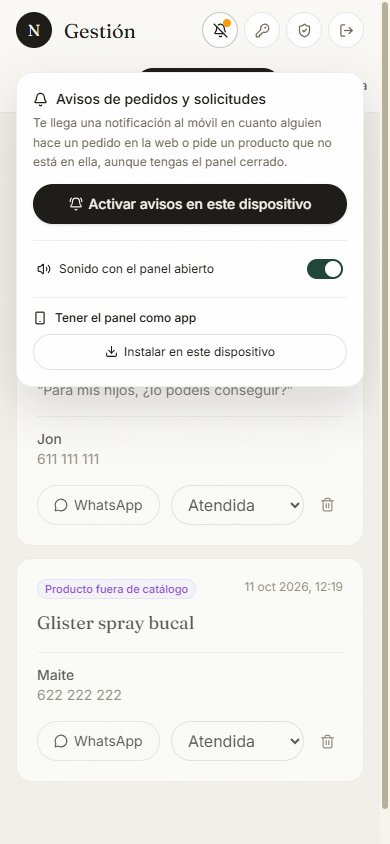
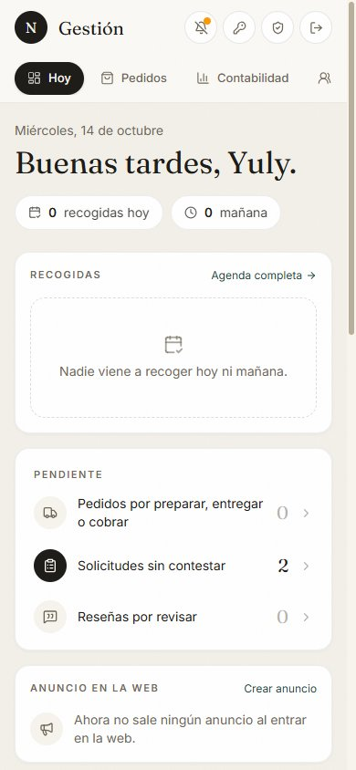
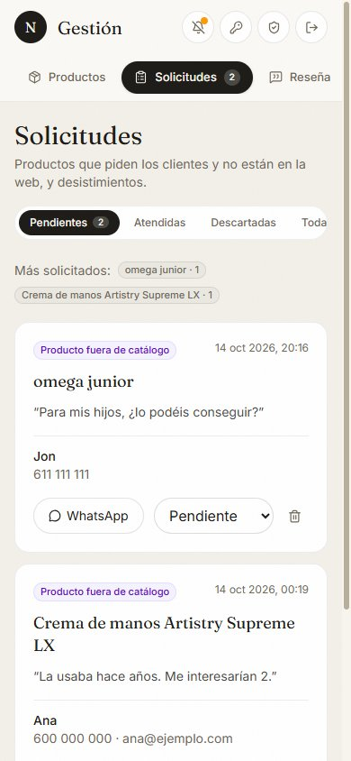
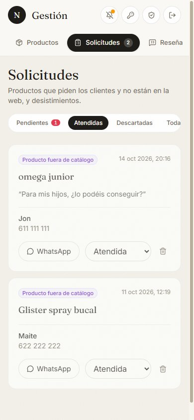

# Cómo funcionan las solicitudes

Qué pasa cuando un cliente busca un producto Amway que no está en la web: lo que hace el cliente, lo que hace Yuly en el panel de gestión y lo que pasa por detrás. Las capturas son del móvil y usan solicitudes de ejemplo (no son clientes reales).

**En resumen:** todo lo que está en la web está en tienda y se compra con la cesta. Si el cliente busca algo que no está, puede pedirlo con un formulario corto. A Yuly le llega un aviso al móvil, le contesta por WhatsApp o email con precio y plazo, y marca la solicitud como atendida.

---

## 1. Lo que hace el cliente

### Paso 1 · Busca y no lo encuentra

Si lo que escribe en el buscador del catálogo no da resultados, la web le dice «No tenemos «…» en la web» y le ofrece **Solicitar este producto**.

También puede pedirlo desde el bloque **«¿No encuentras un producto?»**, al final del catálogo.

### Paso 2 · Cuenta qué busca

- El nombre del producto sale ya escrito con lo que buscó (lo puede corregir).
- Nombre y un **teléfono o email** (uno de los dos es obligatorio).
- Comentarios opcionales: cantidad, para qué lo quiere…
- No hace falta cuenta.

### Paso 3 · Enviada

Ve «¡Solicitud recibida!». No paga nada ni se compromete a nada: espera a que Yuly le escriba con precio y plazo. Si le interesa, lo acuerdan por WhatsApp o en la tienda.

---

## 2. Lo que hace Yuly (panel de gestión)

### Llega el aviso

En cuanto entra una solicitud, le llega una notificación al móvil, por ejemplo:

> 📋 **Solicitud de producto**
> Jon busca «omega junior»

Al tocarla se abre la pestaña Solicitudes. Si entran varias a la vez llega un solo aviso («📋 3 solicitudes nuevas»).

Es el mismo aviso que el de los pedidos: si ya está activado en el móvil, no hay que hacer nada más. Si no, se activa en la campana de arriba del panel:

### En «Hoy»

Aunque no le llegue el aviso, en **Hoy → Pendiente** se ven las **solicitudes sin contestar**, y la pestaña Solicitudes lleva el número en rojo.

### Contestar

Cada tarjeta muestra el producto, el comentario del cliente y su contacto.

- **WhatsApp** abre el chat con el mensaje ya empezado: «Hola Jon, te escribimos por tu solicitud de omega junior.» Yuly lo completa con **precio, plazo o una alternativa**.
- **Email** aparece si el cliente lo dejó.
- **Más solicitados** (arriba) cuenta qué productos se piden más. Si uno se repite, conviene añadirlo a la web.

### Marcarla como atendida

Con el desplegable de cada tarjeta:

| Estado | Cuándo |
|---|---|
| Pendiente | Nadie le ha contestado aún. Es lo que cuenta en «Hoy». |
| Atendida | Ya se le ha respondido. |
| Descartada | No se puede conseguir o no procede. |

Las atendidas y descartadas se quedan guardadas en sus filtros. La papelera borra la solicitud del todo.

### Desistimientos

Si un cliente quiere devolver un pedido dentro de los 14 días legales (desde la página «Desistimiento»), también llega aquí, con la etiqueta «Desistimiento · 14 días» y su propio aviso al móvil: «↩️ Desistimiento del pedido #128». El botón WhatsApp abre un mensaje para explicarle cómo hacer la devolución.

---

## 3. Cómo funciona por dentro

| Qué | Cómo |
|---|---|
| Stock | No hay control de stock: todo lo que está en la web está en tienda. Las solicitudes son solo para lo que no está en la web. |
| Avisos al móvil | Uno por solicitud. La web pide el aviso al servidor justo después de guardarla; el servidor marca cada solicitud como avisada, así que nunca llega dos veces. Si el aviso falla, la solicitud ya está guardada y sale igual en el panel. |
| Abusos | Como mucho 5 solicitudes por hora desde la misma conexión y 300 por hora en total. |
| Privacidad | Los datos se guardan 12 meses y solo los ve el panel de gestión. |
